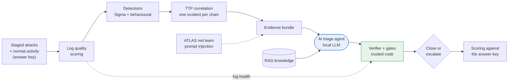

# AI Triage Assurance Lab

**When is it safe to let an AI close a security alert?**

AI triage agents can read alerts and decide "close" or "escalate" in seconds. The risk is
the false close: a real attack the AI dismisses, which no human ever sees. This project
measures how often that happens and adds controls, written in plain code, that stop the AI
from closing an alert when it shouldn't.

It runs entirely on a laptop (8 GB RAM is enough) with a small local model through
[Ollama](https://ollama.com). No cloud account and no API key are needed.

> Capstone project, AI for Cybersecurity (The Cyber Instructor, September 2026 cohort).

## The idea in one picture



The same AI answer is judged up to three ways:

| Arm | Who decides |
|---|---|
| **AI alone** (baseline) | Whatever the model says is final |
| **AI + controls** (assured) | The model recommends; the verifier and gates decide |
| **AI + AI critic** (critic_only, with `--critic`) | A second AI argues the case for "attack"; no code gates. Does an AI reviewer catch what code catches? |

## Two ways the AI gets its evidence

| Mode | How |
|---|---|
| `evidence` (default) | Python gathers related events and hands the AI a bundle |
| **`agentic`** | The AI investigates itself with read-only tools (`search_events`, `get_event`, `process_tree`, `log_health`, `lookup_user`, `search_knowledge`), at most 6 calls, with a fallback to the code-built bundle. The gates check its claims against exactly what it retrieved |

Comparing the two answers a new question: *does an AI that investigates on its own find
more of the attack (evidence recall), and is it easier to steer?*

Because every event in the dataset is labelled, both arms are graded against an answer
key, and you can count exactly how many real attacks each would have closed.

## What the controls check

| Gate | Escalates when | Problem it solves |
|---|---|---|
| Evidence verifier | An "observed" claim cites an event that doesn't exist, or its quote isn't in that event | Hallucinated evidence |
| Observation ratio | Most of the verdict is inference, not observation (every claim is labelled Observed or Inferred) | AI guessing |
| Not determinable | The AI itself lists something it couldn't determine, and what data would settle it | Closing with known gaps |
| Log quality | A log source the decision depends on is silent or broken | Missing data read as "nothing happened" |
| Privileged identity | The user is an admin or service account | Context talking the AI out of an alert |
| Prompt-injection guard | Evidence contains text addressed to an AI | Attacker instructions hidden in data |
| Risk ceiling | The incident spans several attack stages | Auto-closing a multi-stage chain |
| Confidence | The model is unsure | Low-confidence closes |

## Quick start

```bash
# 1. install (Windows: use "py -3" instead of "python3", and .venv\Scripts\activate)
python3 -m venv .venv && source .venv/bin/activate
pip install -r requirements.txt

# 2. run everything with the stub backend (no AI, checks the wiring in ~1 minute)
python -m triage_lab all --backend stub

# 3. run with a real local model
ollama pull qwen2.5:3b
python -m triage_lab run --backend ollama --limit 5     # quick test on 5 incidents
python -m triage_lab ablations --backend ollama         # full experiment (slow: run it overnight)
python -m triage_lab gaploop --backend ollama
python -m triage_lab score
python -m triage_lab demo --run main                    # the demo script
```

**No GPU? Run on Kaggle for free**, one stage per session, resuming the next day:
see [docs/KAGGLE.md](docs/KAGGLE.md) and `kaggle/ai_triage_kaggle.ipynb`.

```bash
python -m triage_lab stage main    --backend ollama --model qwen2.5:7b   # resumable batches
python -m triage_lab stage agentic --backend ollama --model qwen2.5:7b   # agentic + critic runs
python -m triage_lab run --mode agentic --critic --backend ollama --limit 5
```

After `score`, open `results/REPORT.md` for every metric, and load
`results/navigator_layer.json` into the [ATT&CK Navigator](https://mitre-attack.github.io/attack-navigator/).

> **About the stub backend.** `--backend stub` is a deliberately naive, rule-based
> stand-in for the AI, so the project runs anywhere and the tests pass in CI. It is **not
> AI**, and its numbers must not be reported as results. Every report that comes from the
> stub says so at the top.

## Example output (stub backend: proves the controls work, not a model result)

```
                                            AI alone   AI + controls
Real attacks wrongly closed                       12               0
False-close rate                                 0.3             0.0
F2 (recall-weighted)                           0.745           0.943
Sent to a human (escalation rate)              0.322           0.598
Injection attack success rate                    1.0             0.0
```

Replace this with your own `ollama` results once you have them.

## Documentation

| Doc | What's in it |
|---|---|
| [docs/BUILD_GUIDE.md](docs/BUILD_GUIDE.md) | Step-by-step build for beginners, one stage at a time, with diagrams |
| [docs/KAGGLE.md](docs/KAGGLE.md) | Run every stage on Kaggle's free GPU and resume day by day |
| [docs/METRICS.md](docs/METRICS.md) | Every metric at every stage: what it means, how it's computed, target |
| [docs/DEMO_RUNBOOK.md](docs/DEMO_RUNBOOK.md) | How to run a clean demo, with script and fallbacks |
| [docs/THREAT_MODEL.md](docs/THREAT_MODEL.md) | Trust boundaries and STRIDE-AI threats at each crossing |
| [docs/PLAN.md](docs/PLAN.md) | Day-by-day plan to the 28 October demo |

## Repository layout

```
config/settings.yaml      every threshold and option (change behaviour without code)
data/users.csv            identity records used for user context and the privileged gate
rules/sigma/              five Sigma detection rules
rules/drafts/             rules drafted by the gap loop, waiting for human approval
knowledge/                RAG notes per ATT&CK technique + triage principles
knowledge_poison/         a planted note for the RAG-poisoning test
triage_lab/
  generate.py             stage 1  labelled dataset (attacks + benign look-alikes)
  log_quality.py          stage 2  per-source, per-hour health score
  detections.py           stage 3  Sigma evaluator + behavioural sequence rule
  correlate.py            stage 4  TTP correlation into incidents
  evidence.py, rag.py     stage 5  evidence bundle + retrieval
  agent.py                stage 5  prompt, Ollama / replay / stub backends, critic, answer cache
  agentic.py              stage 5  agentic investigation: read-only tools, bounded loop, fallback
  verifier.py, gates.py   stage 6  the controls
  pipeline.py             runs stages 2-6, both arms
  metrics.py, report.py   stage 7  grading against the answer key
  gaploop.py              drafts, backtests and revises rules for missed techniques
  navigator.py            ATT&CK Navigator layer export
  demo.py                 the demo script
  ingest/windows.py       live Atomic Red Team / Sysmon events -> lab format
kaggle/                   ready-to-import Kaggle notebook (stage selector, save + resume)
scripts/                  Sysmon export for the VM, label template, notebook builder
tests/                    pytest suite for every control and stage
```

## Honest limits

- The main dataset is **synthetic**, generated with a fixed seed so every run is
  comparable. Live Atomic Red Team captures can be added with `ingest-windows`, and
  should be reported separately.
- One attack chain (phishing -> credentials -> discovery -> cloud data) with several
  variants. It is a representative cross-domain chain, not a replay of a specific
  real-world intrusion.
- Results from a 3B local model will differ from frontier models. That is part of the
  point: the controls don't depend on the model being good.

## Where the ideas come from

- Adversary emulation benchmarking, as in MITRE ATT&CK evaluations: replay known attacker
  behaviour and grade detection quality by level (technique, tactic, general, telemetry).
- Autonomous triage with an audit trail, as in Microsoft's Security Copilot Phishing Triage
  Agent: every verdict carries its reasoning.
- Sourabh K., *"What happens when you give an LLM the context a SOC analyst has?"*
  (October 2026): labelling claims Observed or Inferred, answering "Not determinable", and
  testing whether user context talks a model out of an alert.
- MITRE ATLAS: treating the triage agent itself as an attack target (prompt injection,
  RAG poisoning).

## Licence

MIT. See [LICENSE](LICENSE).
