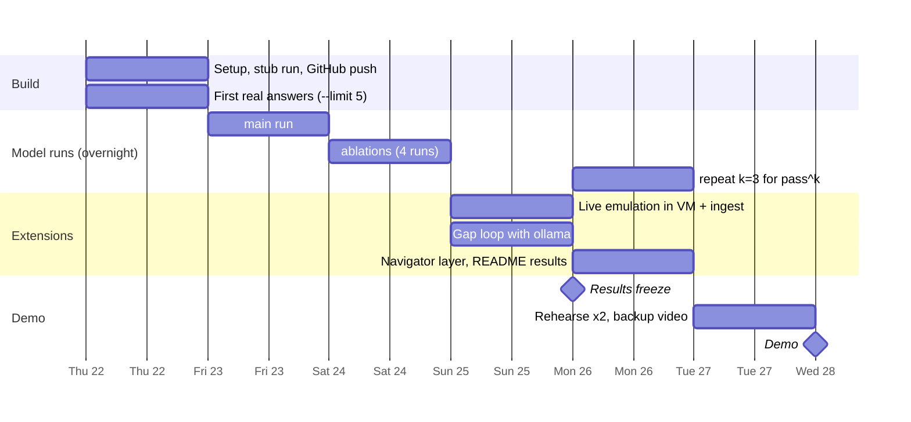

# Plan: Thursday 22 to Wednesday 28 October

The model runs are slow on a laptop (roughly 1 to 1.5 hours for one full run of ~87
incidents with a 3B model on CPU), so the plan puts every long run **overnight** and
spends the days checking results.

Answers are cached by prompt content, so re-running an experiment only calls the model
for incidents whose prompt changed. Adding live emulation later costs one new incident,
not a full rerun.

| Day | Daytime (you) | Overnight (laptop) | Checkpoint by end of day |
|---|---|---|---|
| **Thu 22** | Step 0 setup; `pytest`; stub `all`; push to GitHub; `ollama pull qwen2.5:3b`; `run --backend ollama --limit 5`; read the 5 answers | `run --backend ollama` (main) | Stub end-to-end works; 5 real answers parse as JSON |
| **Fri 23** | Read 10 real answers by eye; if more than 1 in 10 is invalid JSON, adjust the prompt or model, then rerun | `ablations --backend ollama --only payload_only no_context no_rag poisoned_rag` | `main` scored; REPORT section 5 has real numbers |
| **Sat 24** | Score all runs; write the results section of the report (first draft) | (spare: rerun anything that failed) | All 5 runs scored |
| **Sun 25** | Live emulation: VM, 2-3 Atomic Red Team tests, export, ingest; `run --backend ollama` (only new incidents call the model); `gaploop --backend ollama` | `repeat --backend ollama -k 3` | Live scenario in the report; `gap_loop.json` written |
| **Mon 26** | `score`; Navigator layer + screenshot; README results table; slides | — | **Results freeze**: no more model runs after today |
| **Tue 27** | Rehearse the demo twice with `demo --run main`; record backup video; final push | — | Demo runs in under a minute from cache |
| **Wed 28** | Morning check, then **demo** | — | Done |

## If you fall behind

Cut in this order, and keep the core:

1. The `repeat` runs (pass^k): mention it as future work.
2. The gap loop with ollama: show the stub version's backtest instead, labelled as rule induction.
3. Live emulation: cut to one technique (T1069.002 is quick and safe).
4. Two of the four ablations: keep `payload_only` and `no_context`, the two with the clearest story.

**Never cut:** the `main` ollama run, scoring, the demo rehearsal and the backup video.
